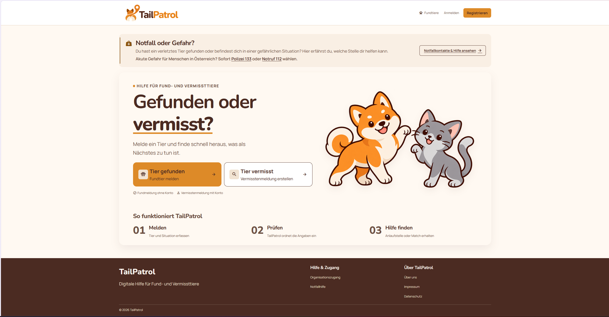
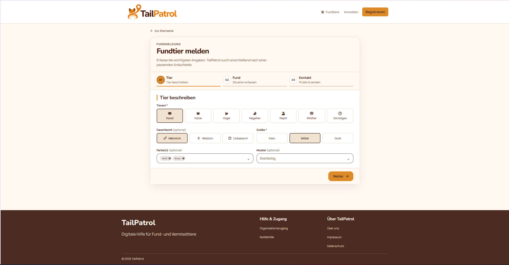
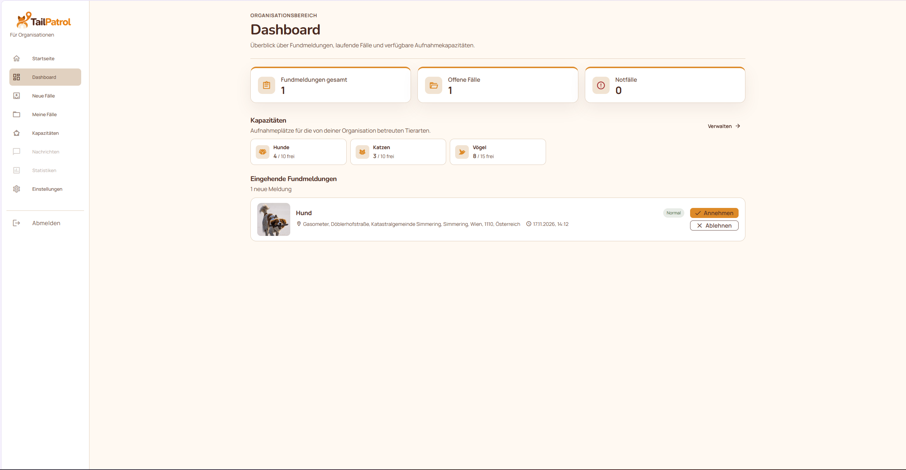
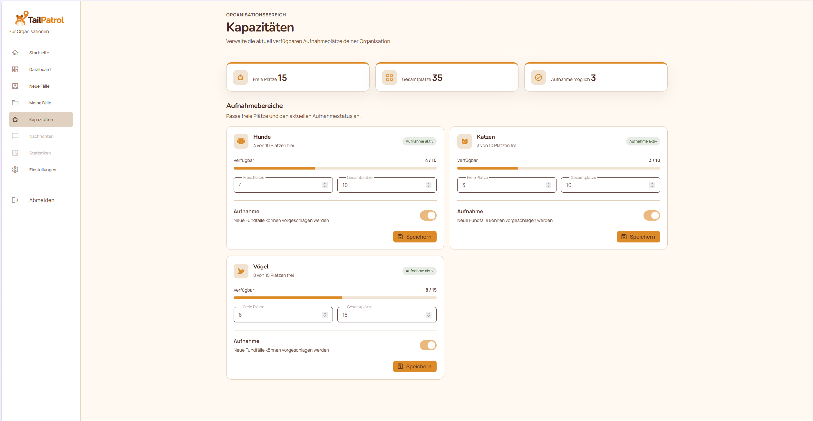
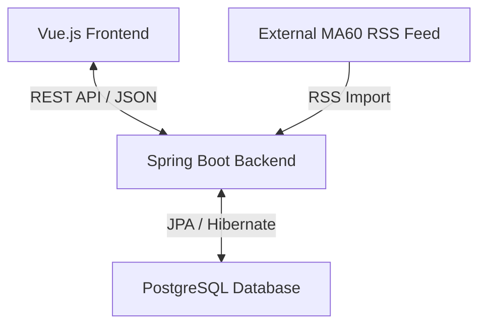
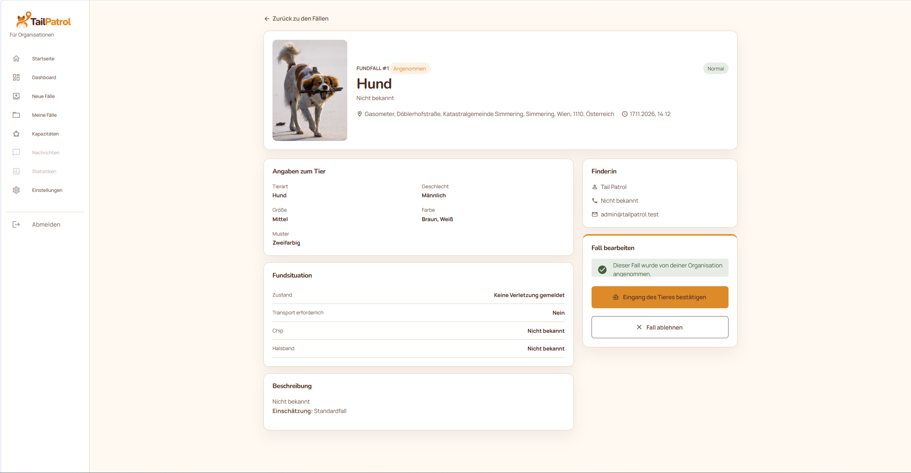

# 🐾 TailPatrol – Animal Reporting Platform

A full-stack web application developed as a team project during my software development training at CODERS.BAY in Vienna.

TailPatrol provides a central platform for reporting found and missing animals, recommending suitable animal welfare organisations and identifying potential matches between animal reports.

> **Note:** This repository is a portfolio case study.
> The original source code was developed collaboratively by a three-person team and is therefore not published here.

## 📸 Application Preview

[View all application screenshots →](screenshots/README.md)

## 🎯 Project Context

- **Team size:** 3 developers
- **Project duration:** 5 weeks
- **Completed:** October 2026
- **Development approach:** Agile team development
- **My primary responsibility:** Frontend development

## 💡 The Problem

When someone finds an animal, it is not always obvious which organisation to contact or what steps to take next.
Animal shelters need structured information about the animal, its condition, the discovery location and available transport options.
At the same time, missing and found animal reports are often distributed across different platforms.
TailPatrol brings these processes together in one application, supporting both citizens and animal welfare organisations.

## ✨ Key Features

### Found Animal Reporting

- Multi-step reporting form
- Animal characteristics and discovery details
- Photo upload and location information
- Guest reporting without an account
- Organisation recommendations based on suitability, distance and available capacity

### Missing Animal Reporting

- Account-based missing animal reports
- Detailed animal descriptions and photos
- Management of active reports
- Automated matching with found animal listings

### Organisation Management

- Organisation-specific dashboard
- Incoming case management
- Acceptance and rejection of assigned cases
- Case status tracking
- Confirmation of animal arrivals
- Management of available intake capacities

### External Data Integration

- Automated import of external found animal listings from the City of Vienna's MA60 RSS feed
- Mapping of external data to internal data structures
- Duplicate detection
- Matching of imported listings with missing animal reports

### Authentication and Access

- User registration and authentication
- Role-based access control
- JWT-based authentication
- Email-based access links for organisations

## 🛠 Technology Stack

| Area | Technologies |
| --- | --- |
| Frontend | Vue 3, JavaScript, Vuetify |
| State Management | Pinia |
| Routing | Vue Router |
| Backend | Java, Spring Boot |
| Security | Spring Security, JWT |
| Database | PostgreSQL, H2 |
| Persistence | JPA, Hibernate |
| Communication | REST APIs, JSON |
| Development Tools | Git, GitLab, Docker, Postman |

## 🏗 Technical Architecture

The frontend communicates with the Spring Boot backend through REST APIs.
The backend handles business logic, authentication, matching, external data integration and data persistence.

## 👩‍💻 My Contribution

My primary responsibility was the development and redesign of the Vue.js frontend.
I implemented most of the application interface, with a focus on connecting user workflows, reusable components and backend functionality.

My contributions included:

- Development of found and missing animal reporting views
- Implementation of the organisation dashboard
- Development of case overview and detail views
- Implementation of organisation capacity management
- Development of user account and report management views
- Creation of reusable UI components and consistent layouts
- Configuration of Vue Router
- Implementation of Pinia stores for organisation data, capacity and cases
- Integration of frontend workflows with REST APIs
- Implementation of responsive layouts using Vue.js and Vuetify

The authentication store, form validation logic and photo upload component were implemented by other team members.

For a more detailed breakdown of my work, see [My Contribution](docs/my-contribution.md).

## 🧠 What I Learned

This project allowed me to apply previously acquired programming skills in a connected full-stack application.

In particular, I gained practical experience in:

- Developing reusable frontend components
- Managing application state across multiple views
- Connecting frontend workflows to backend APIs
- Working with relational data structures
- Integrating and testing features developed by multiple team members
- Coordinating technical requirements and API contracts
- Collaborative software development using Git

The project also strengthened my understanding of how frontend development, backend logic and database persistence interact in a complete application.

## 🔒 Source Code and Project Status

The project was completed in October 2026 as part of my software development training.
To respect the work and wishes of all contributors, the collaborative source code is not published in this repository.
This case study documents the application's functionality, technical architecture, development process and my individual contributions.
The screenshots were captured from a locally running version of the application.
