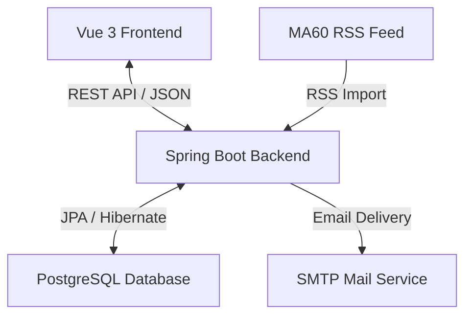
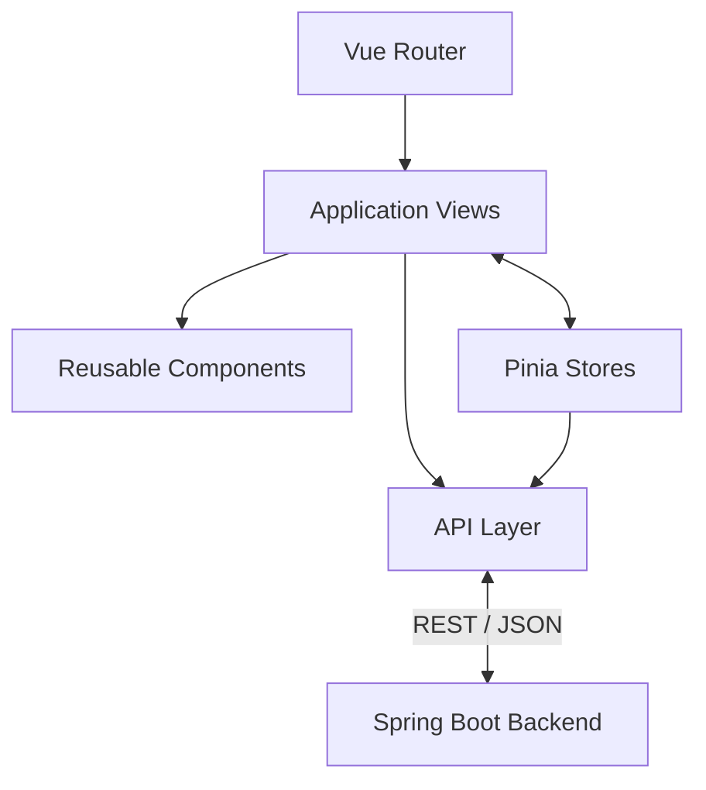
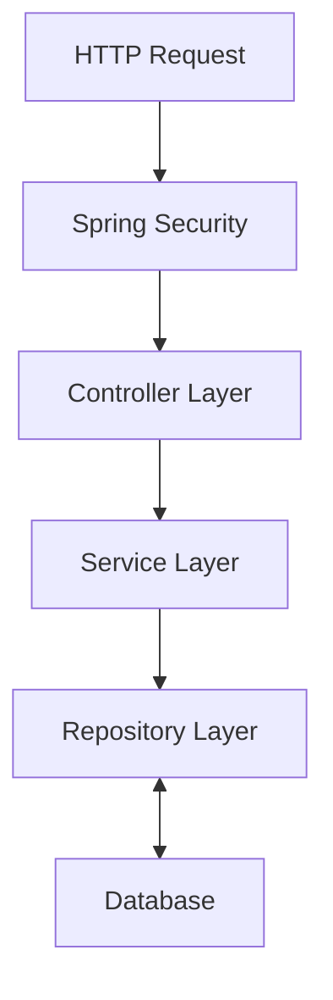
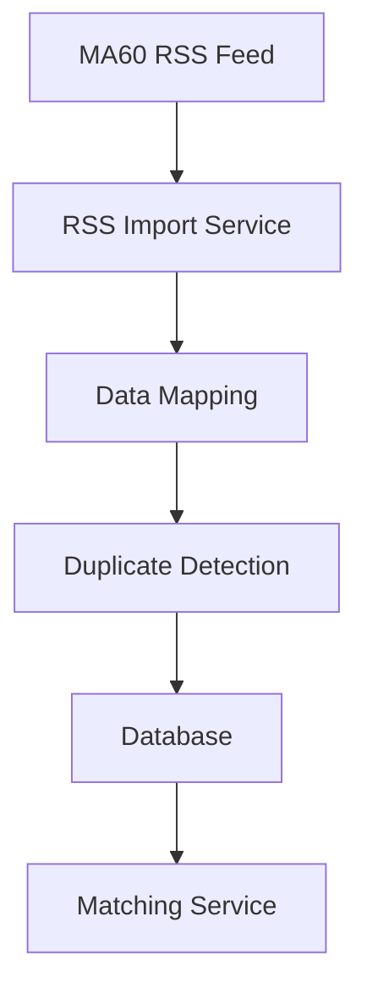

# Technical Architecture – TailPatrol

TailPatrol follows a layered full-stack architecture based on Vue 3, Java, Spring Boot and PostgreSQL.

## System Overview

The frontend is responsible for user interaction and data presentation, while the backend handles business logic, security, data processing and persistence.

## Frontend Architecture

The frontend follows a component-based architecture using Vue 3.

The frontend consists of:
- Application views
- Reusable Vue components
- Shared application layouts
- Vue Router navigation
- Pinia stores
- API integration
- Centralised theme and styling configuration

Vuetify provides UI components and supports responsive layouts.

## Backend Architecture

The backend uses a layered architecture implemented with Java and Spring Boot.

### Controller Layer

- Provides REST API endpoints
- Receives HTTP requests
- Returns response data
- Delegates operations to the service layer

### Service Layer

- Implements business logic
- Processes animal reports
- Handles organisation recommendations
- Manages case-related operations
- Generates potential matches
- Processes external data

### Repository Layer

- Provides database access through Spring Data JPA
- Retrieves and persists application entities
- Supports database queries

## Database and Persistence

PostgreSQL is used as the primary relational database.
H2 supports local development and testing.
Data persistence is implemented using JPA and Hibernate.

The application manages data such as:
- Users and roles
- Found animal reports
- Missing animal reports
- External found animal listings
- Animal characteristics and photos
- Organisations
- Intake capacities
- Potential matches
- Case statuses

## Authentication and Access Control

Authentication and authorisation are implemented using Spring Security.

The application supports three main access models:

| Access Type | Authentication |
| --- | --- |
| Registered users | JWT-based authentication |
| Administrators | JWT-based authentication with administrative permissions |
| Organisations | Token-based access through email links |

Found animal reports can also be submitted by guests without creating a permanent account.

## Organisation Recommendation

When a found animal is reported, the backend evaluates suitable organisations based on relevant criteria, including:
- Animal category
- Organisation type
- Available intake capacity
- Offered services
- Distance to the discovery location

The results are returned to the frontend, where suitable and excluded organisations are displayed.

## Animal Matching

The matching process compares active missing animal reports with available found animal listings.

Relevant comparison criteria include:
- Animal type
- Size
- Gender
- Colours and patterns
- Location
- Temporal information
- Additional animal characteristics

Available chip information and image similarity can provide additional matching signals.

## External RSS Integration

TailPatrol integrates external found animal listings through the City of Vienna's MA60 RSS feed.

The import process:
1. Retrieves external RSS data.
2. Maps external animal characteristics to internal data structures.
3. Prevents duplicate imports using external identifiers.
4. Imports available animal images.
5. Stores the imported animal listings.
6. Triggers the matching process.

The import can be executed automatically through a scheduled task or manually through an administrative endpoint.

## Scheduled Background Tasks

Spring Boot scheduling is used for automated background operations, including:
- External RSS imports
- Cleanup of outdated reports
- Removal of external listings that are no longer available

## Email Integration

The backend supports SMTP-based email delivery for application workflows such as:
- Email verification
- Guest report access
- Organisation access links
- Application-related notifications

Mailpit can be used during local development to test email functionality without delivering real emails.

## Development Environment

The project was developed using:
- Git and GitLab for version control
- Docker for local services
- Maven for backend dependency management and builds
- npm and Vite for frontend development
- Postman for API testing

## Further Information

- [Project Overview](../README.md)
- [My Contribution](my-contribution.md)
- [Application Screenshots](../screenshots/README.md)
