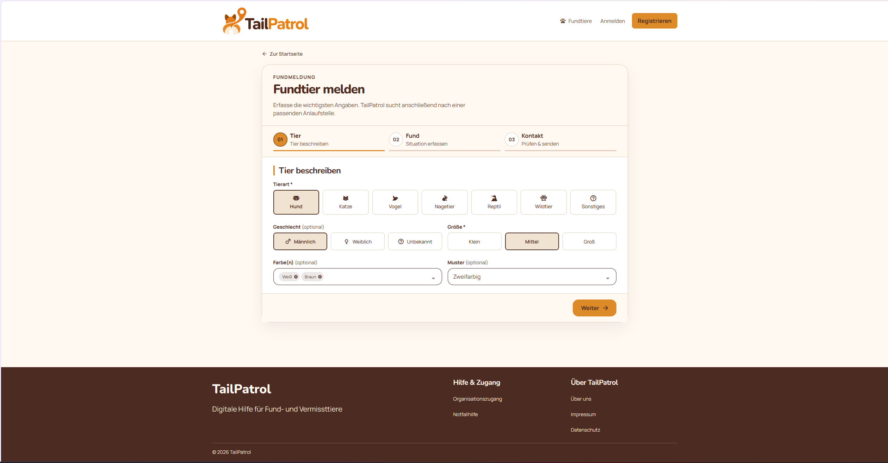
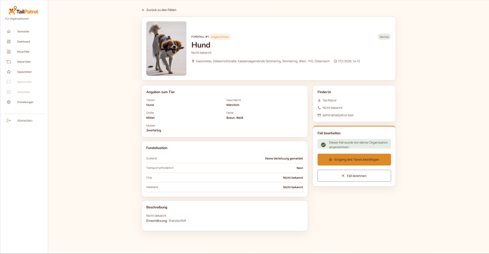
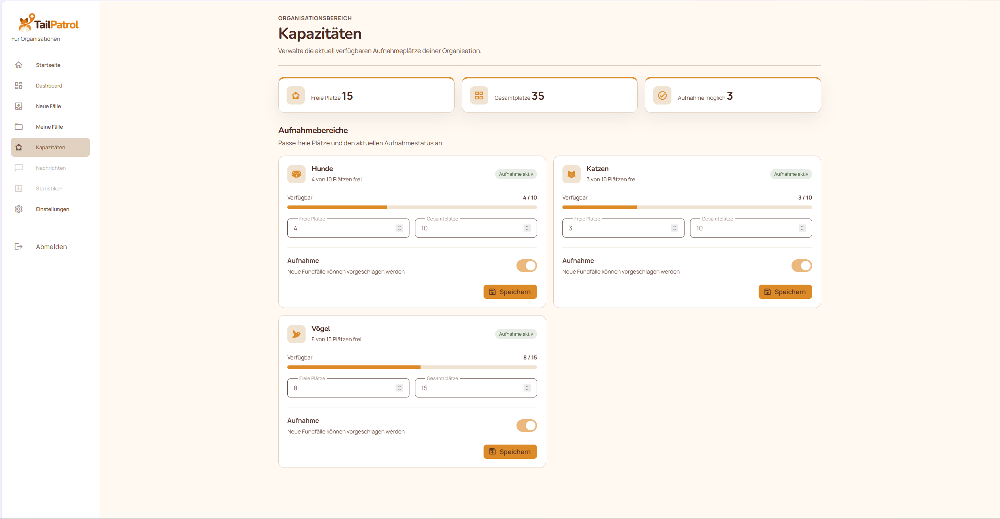

# My Contribution – TailPatrol

## Overview

My primary responsibility in this three-person team project was frontend development and UI redesign.
I implemented most of the Vue.js frontend, including application views, reusable components, routing, state management and organisation-specific workflows.
My focus was on creating a consistent, user-friendly interface while integrating the functionality provided by the backend.

## Frontend Architecture

I structured the frontend around reusable Vue components, dedicated application views, shared layouts and centralised state management.

The main architectural elements included:
- Vue 3 components and views
- Shared layouts for different application areas
- Vue Router for navigation
- Pinia for state management
- Reusable UI components
- Centralised styling and theme configuration
- REST API integration

This structure helped separate responsibilities and reduce unnecessary duplication across the application.

## Application Views

I implemented and redesigned major parts of the application interface.

### Public Area

- Homepage
- Found animal reporting
- Organisation recommendation results
- Missing animal reporting
- Login and registration views

### User Area

- User dashboard
- Personal report management
- Missing animal report details
- Report status representation

### Organisation Area

- Organisation dashboard
- Incoming case overview
- Case management
- Case details
- Capacity management
- Organisation settings

## Multi-Step Reporting Workflows

I worked on the frontend implementation of structured, multi-step reporting workflows for found and missing animals.

These workflows guide users through:
1. Animal characteristics
2. Discovery or disappearance details
3. Contact information and report summary
4. Submission and subsequent actions

I focused on clear navigation, consistent layouts, structured data presentation and integration with the backend.

## Organisation Dashboard and Case Management

A major part of my contribution was the implementation of the organisation-specific frontend.

This included:
- Dashboard statistics and summaries
- Incoming case cards
- Case overview and detail views
- Status-dependent actions
- Acceptance and rejection of cases
- Confirmation of animal arrivals
- Display of animal and contact information

The interface presents different actions depending on the current state of a case.

## Capacity Management

I implemented the organisation capacity management interface.

Organisations can view and manage:
- Total intake capacity
- Available places
- Supported animal categories
- Current intake availability

The interface combines editable data, status indicators, progress bars and summary statistics.

## Reusable Components

I created reusable Vue components for recurring interface elements.

Examples include:
- `AppHeader.vue`
- `AppFooter.vue`
- `MainNavBar.vue`
- `OrganizationSidebar.vue`
- `CapacityCard.vue`
- `IncomingCaseCard.vue`

Reusable components helped maintain a consistent appearance and reduced duplicated implementation across different views.

## State Management

I implemented Pinia stores for organisation-specific data and workflows, including:
- Organisation information
- Organisation capacities
- Organisation cases

Centralised state management allowed related views and components to access shared application data without duplicating state-management logic.

## Routing and Navigation

I implemented the frontend routing structure using Vue Router.

The routing connects:
- Public application pages
- Animal reporting workflows
- User account views
- Organisation dashboards
- Case overview and detail views
- Organisation settings

I also implemented the corresponding navigation elements and shared layouts for the different application areas.

## UI Redesign and Design System

I worked on the visual redesign of the application to establish a consistent identity across its different areas.

This included:
- Centralised colour and typography configuration
- Vuetify theme customisation
- Consistent button and form styling
- Shared page layouts
- Dashboard cards
- Status indicators
- Responsive navigation
- Reusable interface elements
- Responsive desktop and mobile layouts

The design uses a warm colour palette with orange accents, rounded surfaces and consistent visual hierarchies.
The objective was to create an approachable interface while maintaining usability and a coherent visual structure.

## Frontend Data Structures

I created and maintained frontend data structures for:
- Animal categories
- Organisation recommendation results
- Organisation cases
- Intake capacities

These structures support consistent data handling and presentation across views, components and stores.

## Frontend–Backend Integration

I integrated frontend workflows with the Spring Boot backend through REST APIs.

This included:
- Displaying animal reports and organisation data
- Submitting information through reporting workflows
- Displaying organisation recommendations
- Processing case-related actions
- Managing organisation capacity data
- Presenting application status information

This required coordination of request and response structures, shared data models and expected application behaviour.

## Testing and Integration

I participated in testing and integrating frontend and backend workflows.

This included verifying that:
- Submitted reports were correctly processed
- Application data was displayed in the relevant views
- Case-related actions produced the expected results
- Missing animal reports could be marked as resolved
- Frontend workflows remained functional after design changes

## Team Collaboration

The application was developed collaboratively by a three-person team over five weeks.

My work required regular coordination regarding:
- REST API contracts
- Shared data models
- Feature requirements
- Frontend and backend integration
- Git branches and merge requests
- Integration testing

This project provided practical experience in working on a shared codebase with multiple developers.

## Technologies Used

- Vue 3
- JavaScript
- Vuetify
- Vue Router
- Pinia
- HTML
- CSS
- REST APIs
- JSON
- Git and GitLab
- Postman

## Scope of My Contribution

My primary responsibility was frontend development and integration.
The authentication store, form validation logic and photo upload component were implemented by other team members.
The application's backend services, matching algorithms and external data integration are part of the overall team project and are not presented as my individual implementations.

## Further Information

- [Project Overview](../README.md)
- [Application Screenshots](../screenshots/README.md)
