# Application Screenshots

## Homepage

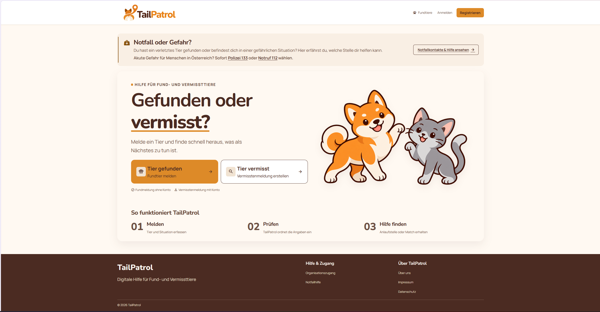

## Found Animal Reporting

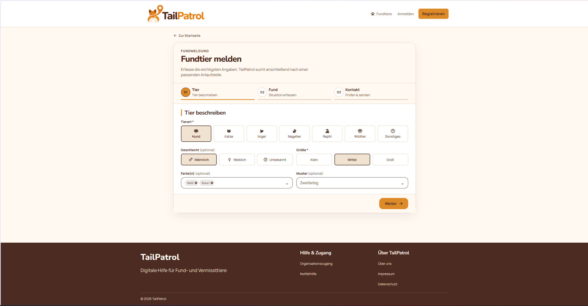

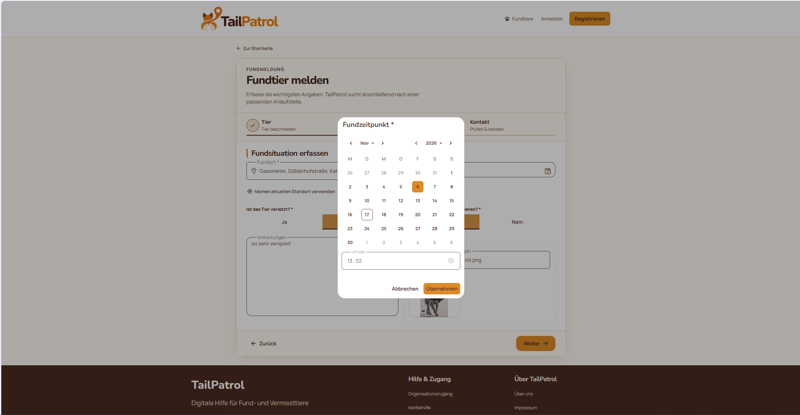

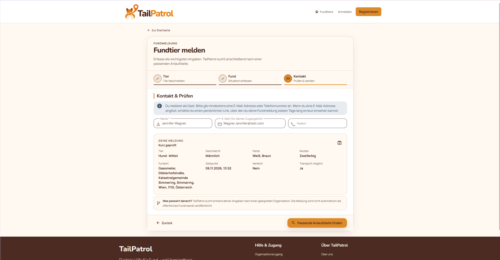

## Organisation Recommendations

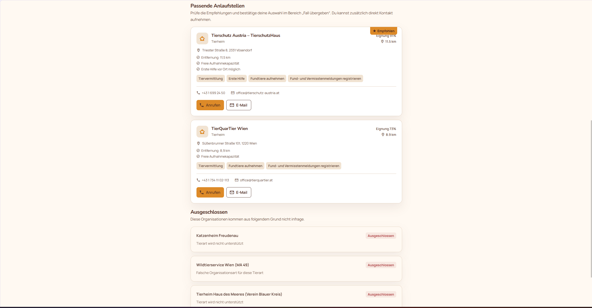

## Missing Animal Reporting

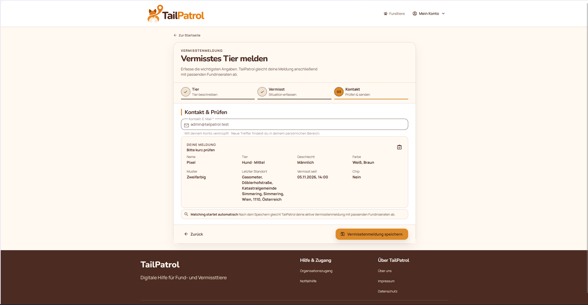

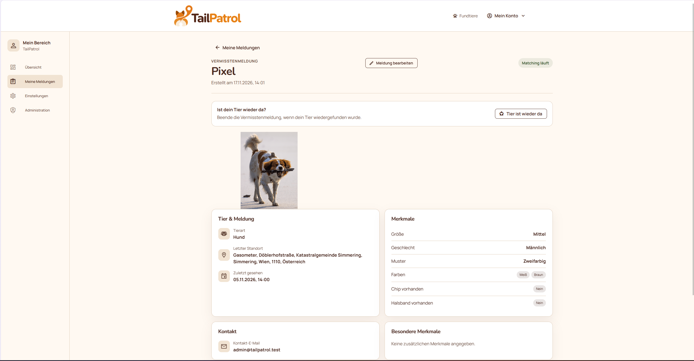

## User Dashboard

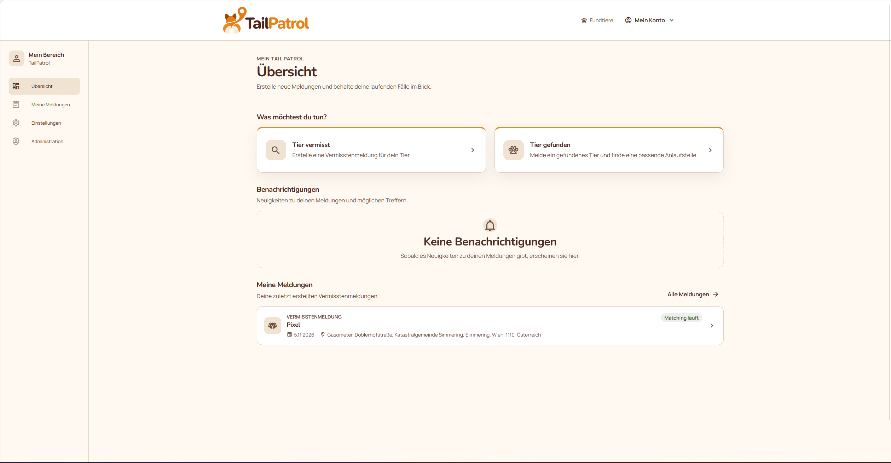

## Organisation Dashboard

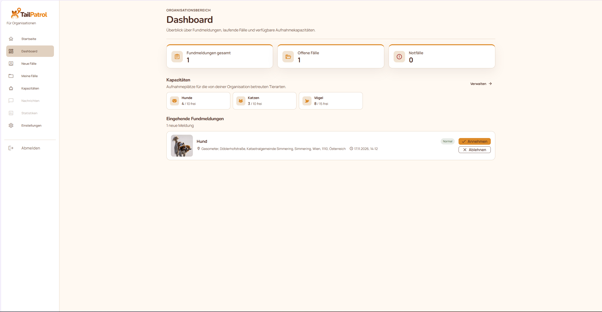

## Case Management

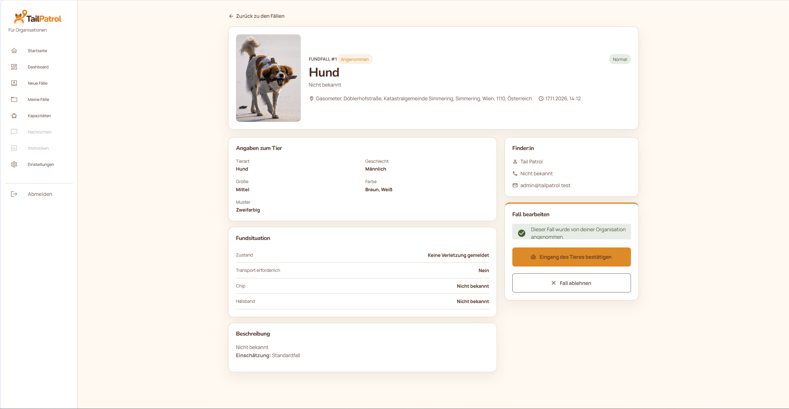

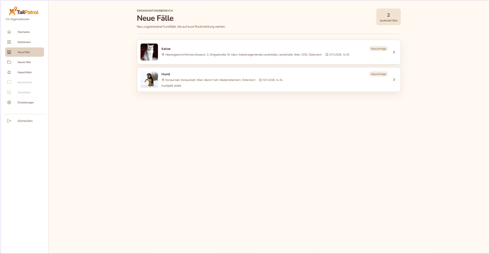

## Capacity Management

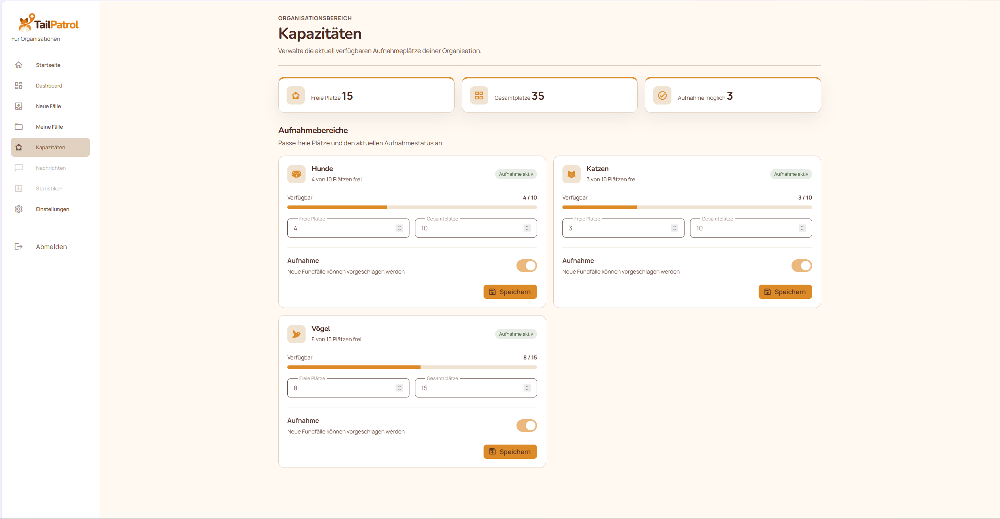

## Responsive Design

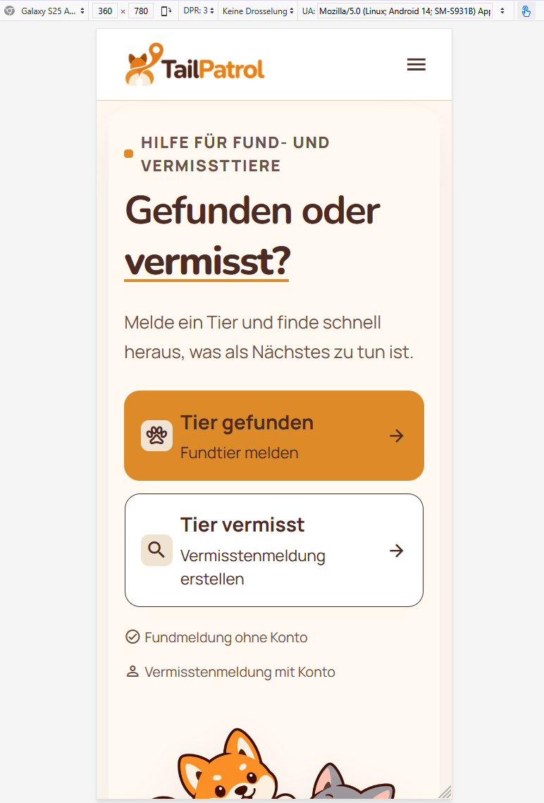
